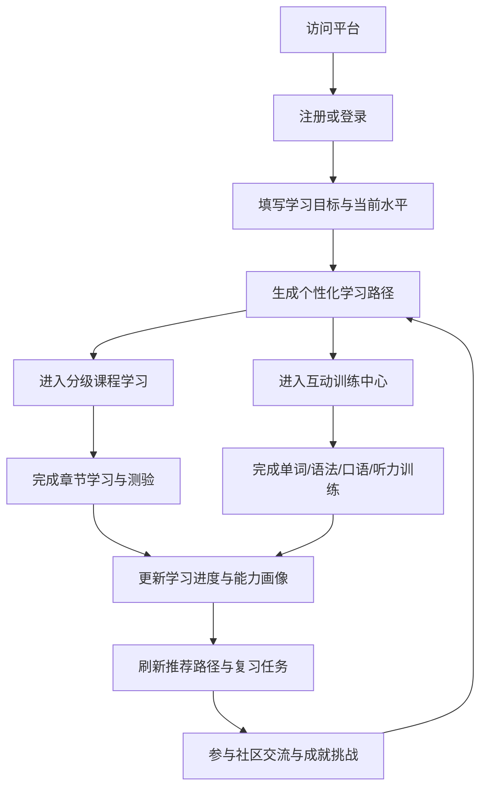

## 1. 产品概述
打造一款面向英语、日语、韩语学习者的多语种在线教育平台，通过课程、互动训练、个性化推荐与社区激励形成持续学习闭环。
- 解决传统语言学习中路径分散、反馈滞后、练习单一与学习动力不足的问题，面向零基础到进阶阶段的学生、自学者与职场用户。
- 通过沉浸式内容体验、智能推荐与成长体系，提高完课率、留存率与用户付费转化潜力。

## 2. 核心功能

### 2.1 用户角色
| 角色 | 注册方式 | 核心权限 |
|------|----------|----------|
| 学员用户 | 邮箱、手机号、第三方账号注册登录 | 学习课程、参与训练、查看进度、加入社区、获得成就 |
| 内容运营/教师 | 平台后台账号 | 配置课程体系、发布练习内容、运营社区话题与活动 |

### 2.2 功能模块
1. **首页/品牌入口**：语言选择、课程导航、学习入口、推荐内容、活动信息。
2. **课程学习页**：分级课程目录、章节学习、课前目标、课后练习、课程解锁机制。
3. **互动训练中心**：单词记忆、语法练习、口语跟读、听力训练四类核心模块。
4. **学习仪表盘**：学习时长、完成率、能力雷达、连续打卡、阶段成绩。
5. **个性化推荐页**：基于目标语言、当前等级、薄弱项与行为数据生成学习路径。
6. **社区与成就中心**：学习小组、问答讨论、打卡动态、徽章墙、排行榜。
7. **登录注册页**：注册、登录、找回密码、欢迎引导、学习目标初始化。

### 2.3 页面详情
| 页面名称 | 模块名称 | 功能说明 |
|----------|----------|----------|
| 首页/品牌入口 | 顶部导航 | 提供语言切换、课程入口、社区入口、登录注册与学习中心快捷访问 |
| 首页/品牌入口 | 语言沉浸式横幅 | 展示英语、日语、韩语学习场景与推荐路径，突出“今日任务”与“立即开始” |
| 首页/品牌入口 | 推荐课程区 | 根据用户等级与目标输出课程卡片、训练入口与社区热点 |
| 登录注册页 | 登录注册表单 | 支持邮箱/手机号登录注册、密码校验、第三方快捷登录 |
| 登录注册页 | 学习目标引导 | 首次注册采集目标语言、当前水平、每日学习时长、学习目标 |
| 课程学习页 | 语言与等级切换 | 支持英语、日语、韩语切换，按 CEFR/JLPT/TOPIK 风格映射分级 |
| 课程学习页 | 课程目录与章节卡片 | 展示级别、课程进度、章节状态、学习目标、预计时长 |
| 课程学习页 | 课程内容区 | 呈现词汇、语法、例句、文化提示、课程测验与下一步建议 |
| 互动训练中心 | 单词记忆模块 | 提供闪卡、拼写测试、错词本、复习频率调度与发音播放 |
| 互动训练中心 | 语法练习模块 | 提供选择题、填空题、纠错题与即时解析反馈 |
| 互动训练中心 | 口语跟读模块 | 支持跟读录音、标准音频对比、发音评分与建议提示 |
| 互动训练中心 | 听力训练模块 | 提供短句、对话、场景听力与分层难度练习 |
| 学习仪表盘 | 进度概览 | 展示今日任务、周/月学习趋势、语言能力成长与连续打卡 |
| 学习仪表盘 | 数据分析区 | 展示词汇掌握度、语法准确率、听说读训练完成率与薄弱项 |
| 个性化推荐页 | 学习路径引擎展示 | 基于当前水平与行为数据，输出近期学习计划、推荐课程与复习任务 |
| 个性化推荐页 | 目标调整面板 | 用户可更新考试目标、时间安排、兴趣主题，实时刷新推荐路径 |
| 社区与成就中心 | 社区动态流 | 发布学习动态、提问、回答、点赞、加入学习小组 |
| 社区与成就中心 | 成就系统 | 展示徽章、经验值、等级、任务完成奖励与排行榜 |

## 3. 核心流程
用户进入平台后先选择目标语言并完成注册/登录，系统根据用户当前水平、目标与学习时间生成初始学习路径。用户可从首页进入课程学习或训练中心完成每日任务，系统持续记录学习行为并在仪表盘中展示进度变化。

当用户完成词汇、语法、口语、听力训练后，平台会结合错题、薄弱项与学习习惯动态调整推荐路径，并通过社区互动、连续打卡、徽章奖励和排行榜维持学习动力，形成“学习-反馈-推荐-激励”的持续闭环。

## 4. 用户界面设计
### 4.1 设计风格
- 主色调：深海蓝、暖金、云白作为基础，分别用珊瑚红、薄荷绿、樱花粉区分英语、日语、韩语视觉主题。
- 按钮风格：大圆角高对比按钮，配合轻微浮雕与发光描边，突出“开始学习”“继续任务”等主操作。
- 字体与字号：标题采用具有教育品牌感的高辨识衬线/人文字体，正文使用清晰易读的无衬线字体，强化沉浸与专业感。
- 布局风格：桌面优先的分栏式学习布局，首页强调叙事感横向导览，学习页采用左导航 + 中央内容 + 右侧进度辅助栏。
- 图标风格建议：使用线性图标结合语言文化元素插画，成就与徽章使用拟物化勋章视觉。

### 4.2 页面设计概览
| 页面名称 | 模块名称 | UI 元素 |
|----------|----------|----------|
| 首页/品牌入口 | 语言沉浸式横幅 | 多语种切换标签、大标题、场景插画、渐变背景、学习 CTA、轻动效 |
| 首页/品牌入口 | 推荐课程区 | 课程卡片、等级标签、学习进度条、悬浮阴影、推荐原因说明 |
| 登录注册页 | 学习目标引导 | 分步表单、进度提示、标签按钮、简洁插画与信息反馈 |
| 课程学习页 | 课程内容区 | 章节导航、内容卡片、语音播放按钮、例句高亮、知识点提示框 |
| 互动训练中心 | 四宫格训练入口 | 模块卡片、能力标签、完成状态、音频/录音控件、即时反馈区 |
| 学习仪表盘 | 数据分析区 | 折线图、雷达图、统计卡片、连续打卡组件、任务进度环 |
| 个性化推荐页 | 学习路径面板 | 路径时间轴、推荐任务卡、薄弱项标签、动态提示条 |
| 社区与成就中心 | 社区动态与徽章墙 | 动态流卡片、评论输入框、排行榜、徽章展示架、经验值条 |

### 4.3 响应式
采用桌面优先设计，平板端保留学习主流程与仪表盘核心信息，移动端对课程导航、训练模块与社区流进行折叠与卡片化适配，并强化触控点击区域与音频操作体验。
