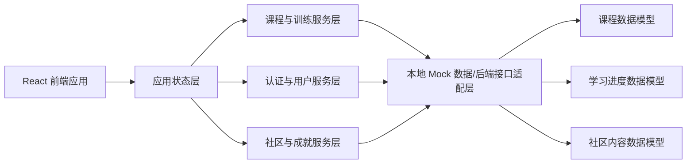
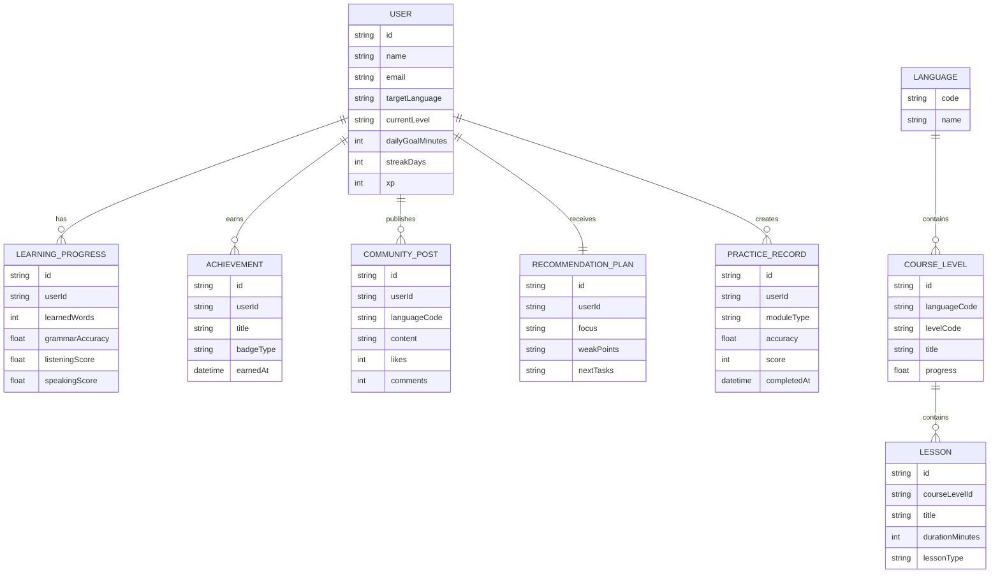

## 1. 架构设计


## 2. 技术说明
- 前端：React 18 + TypeScript + Vite + Tailwind CSS 3
- 路由：React Router 6
- 状态管理：Zustand
- 图表与数据可视化：Recharts
- 动效：Framer Motion
- 表单与校验：React Hook Form + Zod
- 初始化方式：Vite
- 后端：首版以前端 Mock 数据与本地持久化为主，预留接入 Node.js/Express API 的适配层
- 数据存储：开发阶段使用 `localStorage` 与静态 JSON/TS Mock 数据；后续可平滑迁移至 PostgreSQL
- 音频能力：浏览器原生 `audio`、录音 API 与评分占位逻辑，后续可接入第三方语音评测服务

## 3. 路由定义
| 路由 | 用途 |
|------|------|
| / | 平台首页，展示语言入口、推荐内容与品牌价值 |
| /auth | 注册登录与学习目标初始化页 |
| /learn | 分级课程学习主页面 |
| /practice | 互动训练中心，包含单词、语法、口语、听力模块 |
| /dashboard | 学习进度仪表盘与数据分析页面 |
| /path | 个性化学习路径与推荐任务页面 |
| /community | 社区交流、学习小组、动态流与成就中心页面 |

## 4. API 定义
当前版本优先实现前端可运行原型，使用统一的服务接口封装 Mock 数据，保证未来替换为真实后端时页面逻辑无须重写。

```ts
export type LanguageCode = "en" | "ja" | "ko";

export interface UserProfile {
  id: string;
  name: string;
  email: string;
  avatar: string;
  targetLanguage: LanguageCode;
  currentLevel: string;
  dailyGoalMinutes: number;
  learningGoal: string;
  streakDays: number;
  xp: number;
}

export interface CourseLevel {
  id: string;
  language: LanguageCode;
  levelCode: string;
  title: string;
  description: string;
  progress: number;
  unlocked: boolean;
}

export interface PracticeModule {
  id: "vocabulary" | "grammar" | "speaking" | "listening";
  title: string;
  accuracy: number;
  completedToday: boolean;
  recommendedReason: string;
}

export interface RecommendationPlan {
  focus: string;
  weakPoints: string[];
  tasks: Array<{
    id: string;
    title: string;
    type: "course" | "practice" | "review" | "community";
    durationMinutes: number;
  }>;
}

export interface CommunityPost {
  id: string;
  author: string;
  language: LanguageCode;
  content: string;
  likes: number;
  comments: number;
  badge?: string;
}
```

建议的前端服务接口：

| 接口名称 | 说明 |
|----------|------|
| `getCurrentUser()` | 获取当前用户信息与学习目标 |
| `getCourseLevels(language)` | 获取指定语言的分级课程列表 |
| `getPracticeModules(language)` | 获取互动训练模块状态 |
| `getLearningDashboard(userId)` | 获取学习趋势、进度和能力统计 |
| `getRecommendationPlan(userId)` | 获取个性化学习路径与推荐任务 |
| `getCommunityFeed(language)` | 获取社区动态与学习话题 |

## 5. 数据模型
### 5.1 数据模型定义


### 5.2 数据定义语言
当前版本无需真实数据库建表，以下结构用于未来接入 PostgreSQL 时参考：

```sql
CREATE TABLE users (
  id VARCHAR(36) PRIMARY KEY,
  name VARCHAR(100) NOT NULL,
  email VARCHAR(120) UNIQUE NOT NULL,
  target_language VARCHAR(8) NOT NULL,
  current_level VARCHAR(32) NOT NULL,
  daily_goal_minutes INT NOT NULL DEFAULT 20,
  streak_days INT NOT NULL DEFAULT 0,
  xp INT NOT NULL DEFAULT 0
);

CREATE TABLE course_levels (
  id VARCHAR(36) PRIMARY KEY,
  language_code VARCHAR(8) NOT NULL,
  level_code VARCHAR(32) NOT NULL,
  title VARCHAR(120) NOT NULL,
  description TEXT NOT NULL,
  sort_order INT NOT NULL
);

CREATE TABLE learning_progress (
  id VARCHAR(36) PRIMARY KEY,
  user_id VARCHAR(36) NOT NULL,
  learned_words INT NOT NULL DEFAULT 0,
  grammar_accuracy NUMERIC(5,2) NOT NULL DEFAULT 0,
  listening_score NUMERIC(5,2) NOT NULL DEFAULT 0,
  speaking_score NUMERIC(5,2) NOT NULL DEFAULT 0,
  updated_at TIMESTAMP NOT NULL DEFAULT CURRENT_TIMESTAMP
);

CREATE TABLE community_posts (
  id VARCHAR(36) PRIMARY KEY,
  user_id VARCHAR(36) NOT NULL,
  language_code VARCHAR(8) NOT NULL,
  content TEXT NOT NULL,
  likes INT NOT NULL DEFAULT 0,
  comments INT NOT NULL DEFAULT 0,
  created_at TIMESTAMP NOT NULL DEFAULT CURRENT_TIMESTAMP
);
```
